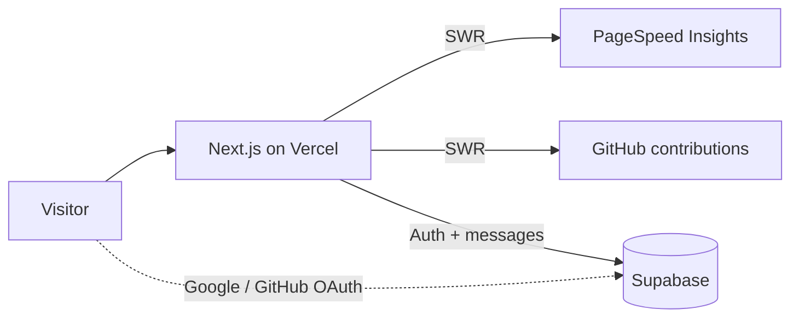

<div align="center">

# nheetxx_

**Personal site of Fajarin Naufal Al Ghazir**
Information Systems student · cybersecurity · building for the web

[**fajarinnaufal.vercel.app**](https://fajarinnaufal.vercel.app)


</div>

---

## What's inside

Most portfolio sites are a static page with a list of skills. This one has two parts that actually do something:

**A live dashboard.** `/dashboard` shows the site's own Lighthouse scores (performance, accessibility, best practices, SEO) for mobile and desktop, pulled from Google PageSpeed Insights and refreshed hourly. Right below it is my GitHub contribution graph for the past year. If I ship something that tanks the score, it's visible to everyone, including me.

**A guestbook with real auth.** `/guestbook` lets visitors leave a message after signing in with Google or GitHub through Supabase Auth. The site never sees a password. Messages are public, and I moderate them directly in Supabase.

The rest is the usual set, kept short:

| Route | Content |
| --- | --- |
| `/` | Intro and links |
| `/about` | Background and what I'm learning |
| `/skillset` | Cybersecurity, systems, and development tools, plus certificates |
| `/experience` | Education and work timeline |
| `/dashboard` | Live PageSpeed scores and GitHub activity |
| `/guestbook` | Public visitor messages |
| `/contact` | Get in touch |

## How the data flows



Pages render first, then SWR fills in the live numbers, so a slow external API never blocks the page.

## Stack

| Layer | Tech | Used for |
| --- | --- | --- |
| Framework | Next.js, TypeScript | Pages, routing, server-side calls |
| Styling | Tailwind CSS | UI |
| Data fetching | SWR | Live data on the dashboard and guestbook |
| Backend | Supabase | Guestbook messages and Google / GitHub login |
| Hosting | Vercel | Deployment |

## Repo layout

```
.github/workflows/   CI
public/images/       static images and certificates
src/                 application code
supabase/            database setup
```

## Run locally

```bash
git clone https://github.com/nheetxx/nheetxxdev.git
cd nheetxxdev
npm install
npm run dev
```

Open `http://localhost:3000`.

## Environment variables
 
Copy the template and fill in your own values:
 
```bash
cp .env.example .env.local
```
 
| Variable | Used for |
| --- | --- |
| `NEXT_PUBLIC_SUPABASE_URL` | Your Supabase project URL |
| `NEXT_PUBLIC_SUPABASE_ANON_KEY` | Supabase public (anon) key, used by the guestbook and auth |
| `PAGESPEED_API_KEY` | Google PageSpeed Insights API key for the dashboard (server-side only) |
 
The PageSpeed key comes from Google Cloud: enable the PageSpeed Insights API on a project and create an API key.
 
## Supabase setup
 
1. Create a Supabase project and put its URL and anon key into `.env.local`.
2. Set up the database using the files in `supabase/`.
3. In Authentication → Providers, enable Google and GitHub, and add `http://localhost:3000` as an allowed redirect URL for local development.

## Contact

[GitHub](https://github.com/nheetxx) · [LinkedIn](https://www.linkedin.com/in/fajarinnaufal) · [Instagram](https://www.instagram.com/nheetxx) · [Guestbook](https://fajarinnaufal.vercel.app/guestbook)